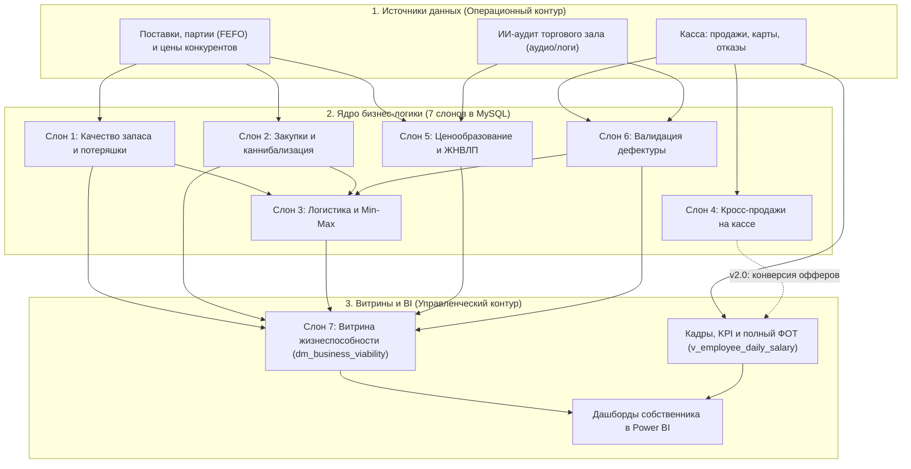
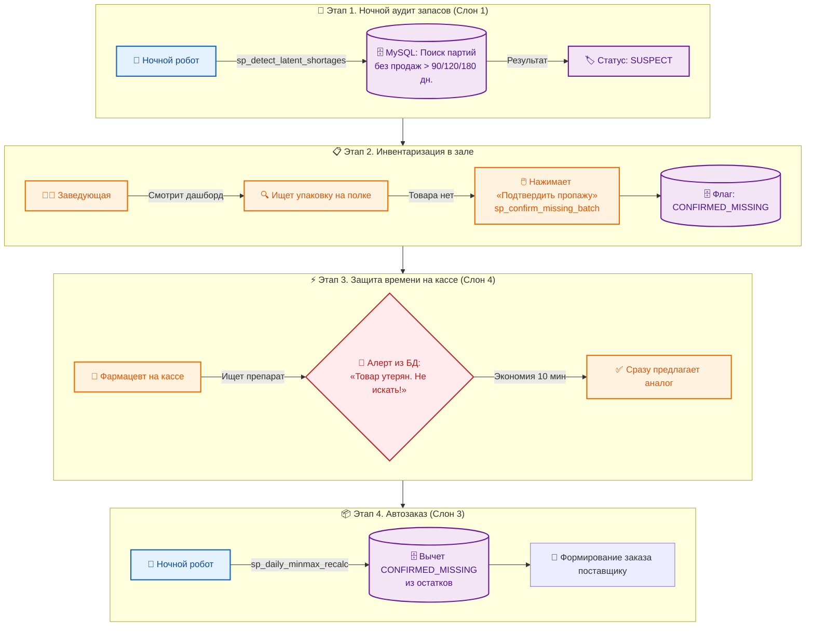
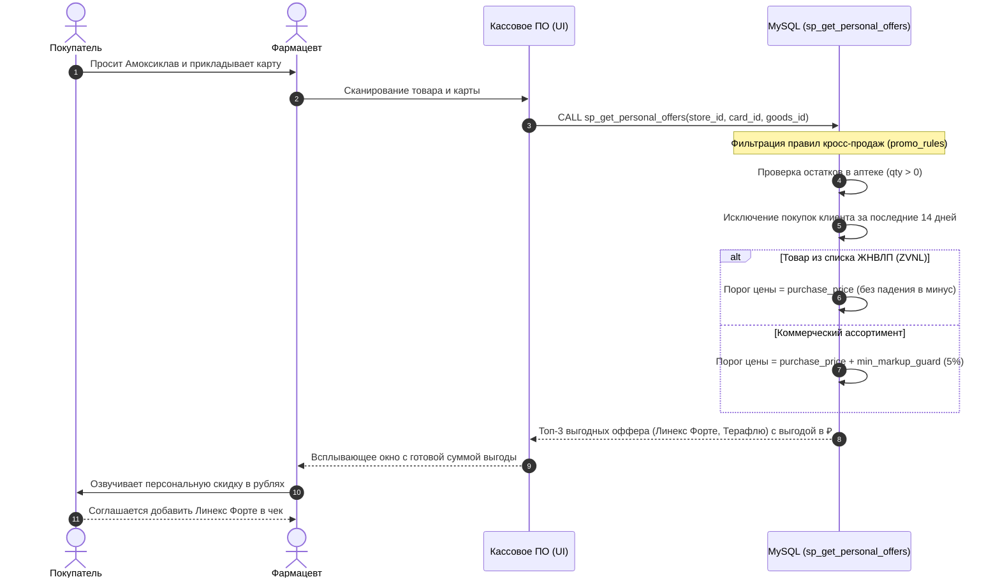

# 🐘 Стая из 7 слонов — Аналитическая платформа управления аптечной сетью (DWH на MySQL 8.0)

[](https://www.mysql.com/)
[]()
[]()
[]()
[]()

Реляционное хранилище данных (DWH) и слой бизнес-логики на уровне СУБД для управления аптечной сетью из **5 точек** разных форматов (флагман, спальный район, прибольничная, дискаунтер, новая точка).

**Масштаб модели:** `22 таблицы` · `10 аналитических представлений (Views)` · `11 хранимых процедур` · `3 триггера`

> **Об авторе:** практик фарм-ритейла (10 лет в домене, из них 5 лет — заведующий аптекой). Перехожу в Системный и Бизнес-анализ.  
> Проект создан как аналитическая «песочница»: я взял реальные операционные боли аптечной сети, которые видел изнутри, и спроектировал для них реляционную архитектуру, алгоритмы расчёта KPI, антифрод и автоматизацию закупок на чистом SQL. Все названия и цифры обезличены.

---

## Содержание
1. [Бизнес-проблема и цели](#1-бизнес-проблема-и-цели)
2. [Архитектура: 7 связанных контуров («Слонов»)](#2-архитектура-7-связанных-контуров-слонов)
3. [Эволюция концепта: от жёсткого антифрода к балансу мотивации](#3-эволюция-концепта-от-жёсткого-антифрода-к-балансу-мотивации)
4. [Ключевые бизнес-процессы и механизации](#4-ключевые-бизнес-процессы-и-механизации)
   - [4.1. Борьба с «латентными недостачами» (потеряшками)](#41-борьба-с-латентными-недостачами-потеряшками)
   - [4.2. ИИ-аудитор зала (Voice-of-Customer) и фильтрация шума](#42-ии-аудитор-зала-voice-of-customer-и-фильтрация-шума)
   - [4.3. Кадровая аналитика: адаптация новичков, увольнения и ФОТ](#43-кадровая-аналитика-адаптация-новичков-увольнения-и-фот)
   - [4.4. Защита от ассортиментного высушивания полки](#44-защита-от-ассортиментного-высушивания-полки)
   - [4.5. Кассовый модуль кросс-продаж (UI/UX перспектива)](#45-кассовый-модуль-кросс-продаж-uiux-перспектива)
5. [Надёжность и производительность DWH](#5-надёжность-и-производительность-dwh)
6. [Схема данных (ER-диаграмма)](#6-схема-данных-er-диаграмма)
7. [Установка, ежедневный регламент и примеры запросов](#7-установка-ежедневный-регламент-и-примеры-запросов)
8. [Демо-сценарии (5 аптек)](#8-демо-сценарии-5-аптек)
9. [Безопасность и план развития (Roadmap v2.0)](#9-безопасность-и-план-развития-roadmap-v20)
10. [Известные ограничения и зоны развития (Known Limitations)](#10-известные-ограничения-и-зоны-развития-known-limitations)
11. [Навыки, продемонстрированные в проекте](#11-навыки-продемонстрированные-в-проекте)
12. [Лицензия и контакты](#12-лицензия-и-контакты)## Содержание

---

## 1. Бизнес-проблема и цели

Аптечная сеть из 5 разноформатных точек сталкивается с классическими проблемами розницы:
* **Замороженный оборотный капитал:** склад забит неликвидом, излишками и препаратами с истекающим сроком годности.
* **Слепые зоны автозаказа:** скрытая дефектура (out-of-stock), «потеряшки» (товар числится в базе, но физически отсутствует на полке) и каннибализация (дешёвый аналог вытесняет высокомаржинальный контрактный препарат).
* **Субъективность на местах:** хаотичное ручное ценообразование заведующих и давление «слепых прогрузов» из центрального офиса.
* **Фрод и искажение данных:** фиктивные отказы на кассе и «эффект кобры» — когда жёсткие штрафы заставляют персонал скрывать проблемы и ломать сбор аналитики.

**Цель проекта:** построить самодостаточное ядро DWH, которое автоматизирует аудит товарных запасов, защищает маржинальность, вычисляет реальный упущенный спрос и даёт руководителю прозрачную картину жизнеспособности каждой точки.

> **Почему «Слоны»?** Метафора притчи о слепых мудрецах: каждый контур отвечает за свой участок бизнеса, но все они связаны через единые справочники и транзакционные таблицы.

---

## 2. Архитектура: 7 связанных контуров («Слонов»)

| Контур | Модуль | Реализованные механики и объекты БД |
| :--- | :--- | :--- |
| **Слон 1** | **Аудит запасов и «Потеряшки»** | Автоклассификация партий на 6 статусов (`LIQUID`, `SURPLUS`, `DEAD_STOCK`, `EXPIRING`, `SUSPECT_STAGNATION`, `INCUBATION`) во вьюхе `v_stock_status`. Детекция застоя (`sp_detect_latent_shortages`), ступенчатая уценка сроков за 3 мес. (-10%) и 1 мес. (-50%) (`sp_expire_repricing`), возврат неликвида между точками (`sp_process_transfer_returns`). |
| **Слон 2** | **Оптимизация закупок и Анти-каннибализация** | Моделирование связки «контрактный SKU — аналог» (`goods_analogs`). Блокировка избыточных «слепых прогрузов» офиса сверх месячной потребности точки с учётом аналогов (`sp_check_office_load`). |
| **Слон 3** | **Логистика и Предиктивный Min-Max** | Расчёт среднедневного расхода (`ADU`) за 14 дней с учётом честных отказов и сезонных коэффициентов (`category_seasonality`). Анти-дефектурный множитель `×3` для приоритетных позиций (`sp_daily_minmax_recalc`). |
| **Слон 4** | **Кассовый интерфейс кросс-продаж** | Генерация персональных предложений (`SECOND_UNIT`, `BUNDLE`) с проверкой истории покупок клиента за 14 дней и жёстким порогом минимальной наценки (`sp_get_personal_offers`, `v_personal_offers`). Контроль рецептурного отпуска (`v_cash_register_scan`). |
| **Слон 5** | **Алгоритмическое ценообразование** | Регрессивная матрица наценок (`markup_matrix`, `sp_night_repricing`). Жёсткий триггер-ограничитель наценки на ЖНВЛП не выше 25% (`tg_znvlp_price_guard`). Мониторинг цен конкурентов (`competitor_prices`) и лимит в 100 локальных ценовых маркеров на аптеку (`tg_pricing_roles_limit`). |
| **Слон 6** | **Управление упущенным спросом и ИИ-аудит** | Регистрация отказов на кассе (`lost_demand_log`) и мгновенная блокировка фиктивных отказов при наличии товара на полке (`tg_validate_lost_demand`). Ночная сверка и расчёт упущенной выгоды (`sp_verify_and_clean_declines`), объединение с голосовым аудитом зала (`v_all_valid_declines`). |
| **Слон 7** | **Исполнительный навигатор (P&L и Мотивация)** | Оценка жизнеспособности точек с прогнозом выполнения плана и присвоением статусов `RENTABLE`, `RISK_ZONE`, `CLOSURE`, `INCUBATION` (`v_viability_live`, `sp_viability_recalc`). Ежемесячный расчёт премиального коэффициента (`sp_motivation_close_month`) и контроль готовности к закрытию зарплатной ведомости (`v_payroll_ready`). |
### Схема взаимодействия контуров (Data Flow)



---

## 3. Эволюция концепта: от жёсткого антифрода к балансу мотивации

В ходе моделирования бизнес-логики выявилась классическая проблема систем контроля — **эффект кобры**:

1. **Итерация 1 (жёсткий контроль):** система блокировала ввод отказа через триггер `tg_validate_lost_demand` (`SIGNAL SQLSTATE '45000'`) и записывала нарушение в `sabotage_log`.
   * *Проблема:* столкнувшись с жёстким контролем, фармацевты могут вообще перестать фиксировать отказы на кассе. В результате Слон №6 слепнет, а Слон №3 перестаёт видеть реальную дефектуру и занижает автозаказ.
2. **Итерация 2 (балансировка и альтернативный канал данных):**
   * Внедрён сбалансированный двухфакторный KPI (`v_employee_daily_salary`): премия сотрудника зависит от среднего геометрического выполнения плана по товарообороту и плана по валовой марже (`SQRT(Выполнение_ТО * Выполнение_Маржи)`). Сотруднику выгодно не терять чек и предлагать замену.
   * Добавлен независимый от кассира слой речевой и видеоаналитики торгового зала (`ai_omni_audit_log`), который страхует автозаказ, если фармацевт забыл нажать кнопку отказа.

**Вывод аналитика:** система не должна заменять управленца. Задача БД — объективно зафиксировать аномалию и посчитать финансовый ущерб, а решение о кадровых беседах принимает заведующая на основе фактов из дашборда.

---

## 4. Ключевые бизнес-процессы и механизации

### 4.1. Борьба с «латентными недостачами» (потеряшками)
1. **Детекция:** процедура `sp_detect_latent_shortages` находит партии с ненулевым остатком, по которым не было продаж дольше нормативного порога (90, 120 или 180 дней), и помечает их флагом `SUSPECT`.
2. **Ревизия:** заведующая проверяет полку и при отсутствии товара вызывает `sp_confirm_missing_batch`, переводя партию в статус `CONFIRMED_MISSING`.
3. **Учёт:** при ночной сверке (`sp_verify_and_clean_declines`) система опирается на чистый остаток (`qty_net`), не штрафуя фармацевта за отказ по физически утерянной позиции.
### Сквозной процесс: выявление и блокировка «потеряшек» (UML Sequence)




### 4.2. ИИ-аудитор зала (Voice-of-Customer) и фильтрация шума
Чтобы минимизировать человеческий фактор при фиксации дефектуры, в DWH спроектирован контур приёма событий аудио-/видеоаналитики (`ai_omni_audit_log` и `ai_demand_log`). Витрина `v_ai_executive_navigator` агрегирует инциденты и формирует для заведующей готовые управленческие инструкции:
* `PRICE_OBJECTION` («Дорого») $\rightarrow$ *Пересмотреть наценку / Внести в LOCAL-маркеры (Слон 5).*
* `DEFECTURA` («Нет в наличии») $\rightarrow$ *Превентивно расширить Мин-Макс (Слон 3).*
* `QUEUE_PEAK` (Очередь у кассы) $\rightarrow$ *Выход заведующей на 2-ю кассу / Пересмотр сменности.*
* `LOW_UX_SKILLS` (Слабая консультация) $\rightarrow$ *Направить сотрудника на обучение.*
* **Шумовой фильтр:** отказы по строго рецептурным препаратам без бланка (`NO_RECIPE`) и внекоммерческий шум (`NON_COMMERCIAL`) отсекаются в рекомендациях и не искажают коммерческую дефектуру.

### 4.3. Кадровая аналитика: адаптация новичков, увольнения и ФОТ
Логика расчёта заработной платы реализована во вьюхе `v_employee_daily_salary` и процедуре `sp_distribute_writeoff_penalty`:
* **Динамическое деление плана:** суточный план аптеки по ТО и марже автоматически делится на актуальное количество активных фармацевтов на точке (`store_staff_counts`).
* **Амнистия новичков (Greenhorns):** если стаж сотрудника (`sale_date - hire_date`) составляет **менее 90 дней**, его итоговый KPI алгоритмически защищён от падения ниже `1.00` (штрафы за невыполнение плана отключены, но повышенный бонус до `1.20` сохраняется). Также новички исключаются из коллективной ответственности за списание просрочки.
* **Учёт увольнений:** при переводе сотрудника в статус `is_active = 0` (и фиксации `termination_date`) система исключает его из расчёта начислений и распределения штрафов.
* **Полная стоимость для бизнеса:** витрина прозрачно раскладывает смену на начисление «грязными», чистую выплату после удержания НДФЛ 13% (`× 0.87`), страховые взносы работодателя 30% (`× 0.30`) и итоговую нагрузку на ФОТ (`× 1.30`).

### 4.4. Защита от ассортиментного высушивания полки
Чтобы заведующие не боялись вводить новые позиции из-за риска депремирования за неликвид, во вьюхе `v_stock_status` реализован коммерческий буфер:
* Для новых экспериментальных позиций (по которым не было приходов за предыдущие 365 дней) порог признания партии неликвидом (`DEAD_STOCK`) увеличен со стандартного срока группы до **180 дней**.
* Если по товару прошла хотя бы одна продажа за последние 30 дней, система автоматически возвращает ему статус `LIQUID`.
### Логика подбора персонального оффера и защита маржи (UML Sequence)




### 4.5. Кассовый модуль кросс-продаж (UI/UX перспектива)
Процедура `sp_get_personal_offers` подготовлена для интеграции с фронтендом кассового ПО. При сканировании карты лояльности и основного товара она возвращает до 3 релевантных допродаж с готовой выгодой в рублях:

> **POS-терминал | Карта клиента:** `#1000001`  
> **Товар в чеке:** Амоксиклав 1000 мг №14
>
> | № | Персональное предложение | Было | Стало | Выгода клиента | Касса |
> | :--- | :--- | :---: | :---: | :---: | :---: |
> | **1** | **Линекс Форте №14** | ~~540.00 ₽~~ | **486.00 ₽** | **54.00 ₽** | `[ + Добавить ]` |
> | **2** | **Терафлю №10** | ~~300.00 ₽~~ | **270.00 ₽** | **30.00 ₽** | `[ + Добавить ]` |


## 5. Надёжность и производительность DWH

* **Транзакционная целостность (ACID):** все критические операции изменения цен, списания просрочки и распределения штрафов (`sp_expire_repricing`, `sp_night_repricing`, `sp_verify_and_clean_declines`, `sp_distribute_writeoff_penalty`) обёрнуты в явные транзакции `START TRANSACTION ... COMMIT` с обработчиком исключений `DECLARE EXIT HANDLER FOR SQLEXCEPTION ROLLBACK`. Это исключает рассинхронизацию финансовых логов и складских остатков при сбоях.
* **Оптимизация под 500 000+ чеков:** при нагрузочном тестировании на годовом массиве продаж (500k строк) время формирования тяжёлой зарплатной витрины `v_employee_daily_salary` (с вычислением корней KPI, НДФЛ и взносов) было сокращено **с 3 минут до 0.109 секунды** за счёт:
  1. Добавления покрывающего составного индекса `idx_sales_DWH_range_perf (sale_date, store_id, goods_id)` на таблицу `sales`.
  2. Настройки буферного пула InnoDB (`innodb_buffer_pool_size = 4G`) для удержания рабочих индексов в оперативной памяти.

---

## 6. Схема данных (ER-диаграмма)

> *Рекомендация: поместите скриншот ER-диаграммы из DBeaver в папку `docs/er_diagram.png`.*

Структура хранилища спроектирована по схеме **«Звезда»**:
* **Центральные измерения (хабы):** `stores` (аптеки), `goods` (номенклатура), `employees` (персонал), `bonus_cards` (клиенты).
* **Факты и транзакционные журналы:** `sales` (чеки), `goods_batches` (партионные остатки с вычисляемыми полями наценки и чистого закупа без НДС), `lost_demand_log` и `ai_omni_audit_log` (отказы и события зала), `transfers` (перемещения), `repricing_log` и `expiry_writeoffs` (переоценки и списания).
* **Витрина данных (Data Mart):** `dm_business_viability` (ежедневные снапшоты экономики сети).

---

## 7. Установка, ежедневный регламент и примеры запросов

### Развёртывание БД (MySQL 8.0+)
```bash
# 1. Создание базы данных
mysql -u root -p -e "CREATE DATABASE IF NOT EXISTS apteka_bober CHARACTER SET utf8mb4 COLLATE utf8mb4_unicode_ci;"

# 2. Импорт структуры, триггеров, процедур и представлений
mysql -u root -p apteka_bober < dump-apteka_bober.sql
```

### Ежедневный цикл ночного регламента DWH
```sql
CALL sp_detect_latent_shortages(CURDATE());          -- 1. Поиск «потеряшек» (SUSPECT)
CALL sp_process_transfer_returns(CURDATE());         -- 2. Возврат непроданных перемещений донорам
CALL sp_expire_repricing(CURDATE(), @msg1);          -- 3. Уценка истекающих сроков и списание просрочки
CALL sp_night_repricing(CURDATE(), @msg2);           -- 4. Пересчёт розничных цен по матрице наценок
CALL sp_daily_minmax_recalc(CURDATE());              -- 5. Пересчёт ADU и лимитов автозаказа (Слон 3)
CALL sp_verify_and_clean_declines(CURDATE(), @msg3); -- 6. Валидация кассовых отказов и расчёт упущенной выгоды
CALL sp_check_zero_declines(CURDATE());              -- 7. Аудит саботажа фиксации отказов по точкам
CALL sp_distribute_writeoff_penalty(CURDATE(), @msg4); -- 8. Распределение штрафов за просрочку (с амнистией новичков)
CALL sp_viability_recalc(CURDATE());                 -- 9. Обновление витрины жизнеспособности бизнеса
```
*(В конце месяца дополнительно вызывается `CALL sp_motivation_close_month(DATE_FORMAT(CURDATE(), '%Y-%m-01'));` для расчёта корректировки KPI по сети).*

### Примеры аналитических запросов
```sql
-- 1. Проверить статус жизнеспособности всех 5 аптек в реальном времени
SELECT store_id, to_current, margin_current_rub, liquid_share_pct, 
       lost_profit_rub, plan_gap_pct, viability_marker, marker_comment
FROM v_viability_live;

-- 2. Посмотреть расчёт зарплаты сотрудников с учётом амнистии новичков
SELECT `Дата смены`, `Аптека`, `Сотрудник`, `Стаж (дней)`, 
       `Расчетный KPI`, `Итоговый KPI`, `Примечание`, `ЗП чистыми (руб)`
FROM v_employee_daily_salary
ORDER BY `Дата смены` DESC LIMIT 10;

-- 3. Получить управленческие рекомендации ИИ-аудитора зала
SELECT * FROM v_ai_executive_navigator;
```

---

## 8. Демо-сценарии (5 аптек)

База спроектирована для моделирования 5 контрастных бизнес-кейсов:

| Аптека | Сегмент | Бизнес-ситуация | Реакция системы |
| :--- | :--- | :--- | :--- |
| **№1 «Центральная»** | `FLAGSHIP` | Высокая доля ликвида (> 65%), выполнение плана > 95%. В штате есть стажёр со стажем < 90 дней. | Статус `RENTABLE`. Стажёр защищён от понижающего KPI и штрафов за просрочку. |
| **№2 «Спальный»** | `RESIDENTIAL` | Накоплен неликвид и излишки (> 20%), есть фиктивные отказы. | Статус `RISK_ZONE`. Фиктивные отказы попадают в `sabotage_log`, ведомость блокируется до распределения списаний (`v_payroll_ready`). |
| **№3 «Прибольничная»** | `HOSPITAL` | Высокая дефектура по приоритетным позициям (упущенная маржа > 15% от ТО), маржа не покрывает аренду и ФОТ. | Статус `CLOSURE`. Алгоритм `sp_daily_minmax_recalc` применяет множитель `×3` к `calc_min`/`calc_max`. |
| **№4 «Дискаунтер»** | `DISCOUNTER` | Офис пытается сделать «слепой прогруз» (`OFFICE_LOAD`) сверх месячной потребности точки. | Процедура `sp_check_office_load` блокирует поставку, а `v_stock_status` не учитывает офисный прогруз в чистом запасе (`qty_net`). |
| **№5 «Новая»** | `NEW` | Точка открыта менее 30 дней назад, идёт период раскачки. | Статус `INCUBATION`. Отключены санкции за невыполнение плана и аудит нулевых отказов. |

---

## 9. Безопасность и план развития (Roadmap v2.0)

### Информационная безопасность и ролевая модель (RLS)
В демонстрационном контуре данные обезличены и открыты для аудита. При переводе платформы в промышленную эксплуатацию (Production) закладывается разграничение прав доступа на уровне строк (**Row-Level Security, RLS**):
* **Фармацевт:** доступ только к кассовому интерфейсу (`v_cash_register_scan`, `sp_get_personal_offers`) и личному расчётному листку без видимости показателей коллег.
* **Заведующий аптекой:** доступ к операционным показателям, остаткам и KPI сотрудников строго в рамках своей точки (`store_id`).
* **Собственник / Финансовый директор:** полный доступ к сводной витрине жизнеспособности (`dm_business_viability`), налогам и полной стоимости ФОТ по всей сети.

### Вектор развития архитектуры (v2.0)
* **BI-визуализация (в работе):** подключение **Power BI** (3 управленческих экрана: сводный P&L сети с переключателем Брутто/Нетто, товарная матрица и дефектура, HR-аналитика и дисциплина точек).
* **Замыкание контура кросс-продаж (Слон 4 ➔ HR/BI):** добавление таблицы логирования показов и конверсий персональных офферов (`offer_shown` / `offer_accepted`) для расчёта персональной конверсии допродаж каждого фармацевта.
* **Синтез реалистичного датасета:** генерация 50 000+ чеков, карт лояльности и логов речевого ИИ-аудита на **Python** с учётом сезонности и профилей каждой из 5 аптек.


---

## 10. Известные ограничения и зоны развития (Known Limitations)

1. **Учёт партий в продажах (FEFO):** в текущей версии схемы таблица `sales` фиксирует продажи в разрезе `store_id` и `goods_id` без прямой привязки к `batch_id`. В следующей итерации планируется добавить связь `sales.batch_id -> goods_batches.batch_id` и процедуру автоматического списания с ближайшим сроком годности (`FEFO`).
2. **Учёт увольнений по дате:** во вьюхе `v_employee_daily_salary` фильтрация уволенных выполняется по флагу `is_active = 1`. Для ретроспективного пересчёта прошлых периодов целесообразно добавить проверку `AND (e.termination_date IS NULL OR s.sale_date <= e.termination_date)`.
3. **Визуализация:** проект сфокусирован на бэкенд-логике DWH. Для работы конечных пользователей поверх готовых витрин (`v_viability_live`, `v_ai_executive_navigator`) планируется подключение BI-системы (Metabase или Apache Superset).

---

## 11. Навыки, продемонстрированные в проекте

* **Бизнес-анализ:** формулировка проблем, построение User Story (потеряшки, новички, увольнения), описание бизнес-процессов «As-Is» и «To-Be», баланс мотивации («эффект кобры»).
* **Системный анализ:** проектирование схемы данных (ER-диаграмма, схема «Звезда»), моделирование процессов и потоков данных (`Flowchart`, `UML Sequence`), нормализация, ролевая модель безопасности (`RLS`).
* **SQL (MySQL 8.0):** триггеры (`SIGNAL SQLSTATE`), хранимые процедуры с транзакциями (`ACID`), сложные аналитические представления (`CTE`, `CASE`, `SQRT`), оптимизация составных индексов под DWH (ускорение витрины ФОТ с 3 минут до 0.1 сек).
* **Фарм-домен:** ЖНВЛП, ретро-бонусы, сроки годности, дефектура, каннибализация контрактных позиций, латентные недостачи, партионный учёт `FEFO`.
* **Управление персоналом:** мотивация через сбалансированный KPI (ТО × Маржа), амнистия новичков `< 90 дней`, учёт увольнений, расчёт полной стоимости сотрудника (ФОТ + налоги и страховые взносы).

---

## 12. Лицензия и контакты

Учебный портфолио-проект. Открыт для изучения, ревью и обсуждения.  
**Автор:** Владислав Баталов · [GitHub](https://github.com) 

